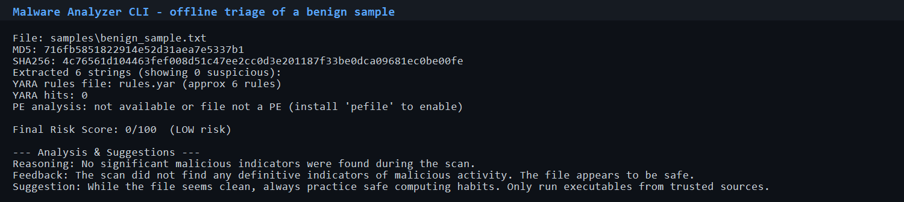
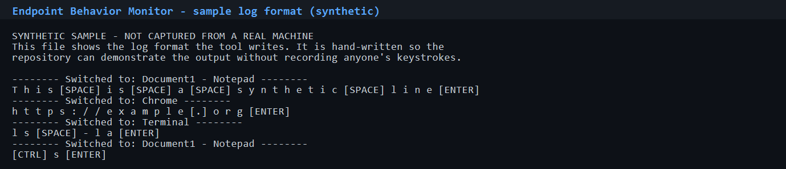

# Security Tools and Prototypes

Small defensive tools, each built to answer one question that came up during lab
work or an investigation. They live in one repository because they share the same
shape: one command, one input, one answer, and an honest statement of what the
answer cannot tell you.

None of these is a product. There is no server to deploy, no tenant model, no
telemetry and no claim of production readiness. Most are Python standard library
only, and the ones that are not say so in their own README.

## Tools

Every row links to something you can open without installing anything: a committed
sample report, a sample log, or a screenshot of a real run.

| Tool | What it does | Runs on | Evidence |
|---|---|---|---|
| [FwScan](tools/fwscan/) | Reads a firewall deny log and separates sweep, subnet-wide and distributed port scans, with the reasoning for each source | Python 3.10+, no dependencies | [sample report](tools/fwscan/examples/report.txt) |
| [LogTriage](tools/log-triage/) | Ranked findings, indicator inventory with first and last seen times, Markdown and JSON report | Python 3.10+, standard library only | [sample Markdown + JSON](tools/log-triage/sample_output/) |
| [Endpoint Behavior Monitor](tools/endpoint-monitor/) | Windows keystroke and active-window logger, kept to study how that telemetry is produced | pynput, pygetwindow; authorised hosts only | [sample log (synthetic)](tools/endpoint-monitor/samples/key_log_sample.txt) |
| [Malware Analyzer CLI](tools/malware-analyzer/) | File triage: hashes, YARA rules, PE metadata, optional VirusTotal lookups | Python 3.8+; the offline path needs no keys | [sample report (txt + json)](tools/malware-analyzer/samples/) |
| [Phishing Mail Detector](tools/phishing-mail-detector/) | `.eml` header and content analysis with a SAFE / CAUTIOUS / UNSAFE verdict | Python 3.8+; `--no-vt` runs offline | [sample verdict + JSON](tools/phishing-mail-detector/samples/) |
| [File Intelligence Platform](tools/file-intelligence/) | Local-first file inventory and sensitive-data discovery with a small web UI | Python 3.12+, Node 20+ to build the UI | [dashboard screenshot](tools/file-intelligence/docs/screenshots/dashboard.png) · [sample data](tools/file-intelligence/examples/sample-data/) |
| [ThreatSentry AI](tools/threat-sentry/) | Shodan and NVD prototype that scores exposed hosts and drafts alerts | see its README; a Shodan key is needed for live data | [dashboard screenshot](tools/threat-sentry/assets/screenshots/Screenshot%202026-01-10%20153154.png) |

The malware and phishing samples are committed next to the exact commands that
produced them, so the output can be reproduced. The endpoint log is synthetic on
purpose: recording real keystrokes is not something to demonstrate.

## Screenshots

Real output from real runs on this machine, not mockups.

| FwScan | LogTriage |
|---|---|
|  |  |

| Malware Analyzer CLI | Phishing Mail Detector |
|---|---|
|  |  |

| Endpoint Behavior Monitor | File Intelligence Platform |
|---|---|
|  |  |

**ThreatSentry AI** - main hunting interface:


## Why one repository

Each of these started as its own repository. Seven small repositories with one
commit or two each read as noise on a profile and made every tool harder to find,
so they were merged here with their commit history intact:

```text
git merge -s ours --no-commit --allow-unrelated-histories <tool>/main
git read-tree --prefix=tools/<slug>/ -u <tool>/main
```

Every original commit is reachable in `git log`, and the seven standalone
repositories have been retired in favour of this one. The history is the part
worth keeping, and it is here.

If you followed an old link, the mapping is: `FwScan` → [`tools/fwscan/`](tools/fwscan/),
`LogTriage` → [`tools/log-triage/`](tools/log-triage/),
`Endpoint-Behavior-Monitor` → [`tools/endpoint-monitor/`](tools/endpoint-monitor/),
`Malware_Analyzer_CLI` → [`tools/malware-analyzer/`](tools/malware-analyzer/),
`Advance_Phishing_Mail_Detector_CLI` → [`tools/phishing-mail-detector/`](tools/phishing-mail-detector/),
`File-Intelligence-Platform` → [`tools/file-intelligence/`](tools/file-intelligence/),
`ThreatSentry-AI` → [`tools/threat-sentry/`](tools/threat-sentry/).

## What is deliberately not here

The five analyst tools that were folded into one workbench live there and only
there: IOC lookup, malware analysis, phishing analysis, EVTX event analysis and
detection-rule translation are all in SecLyst, which is still in development and
private until that work settles. Nothing is duplicated between the two.

RuleForge, ServiceSentinel and SOC IR Trainer are large enough to stand on their
own and stay as separate repositories.

## Limits that apply to all of them

- Each tool answers a narrow question about one input. None of them detects "an
  incident", and none replaces reading the evidence.
- No CI runs at this root. The per-tool workflow files came along in the merge but
  only execute from a repository root, so treat the test claims in each tool's
  README as something to run yourself: `python run.py verify` for RuleForge,
  `pytest` for ServiceSentinel.
- Two tools call external services (VirusTotal, Shodan). Without keys they fall
  back to offline checks, and the verdicts are weaker for it.
- Quality varies with age. The 2025 scripts were learning work; the newer tools
  have tests.
- The problem definitions, detection logic and every limitation written above are mine.

## Licence

MIT. See `LICENSE`.