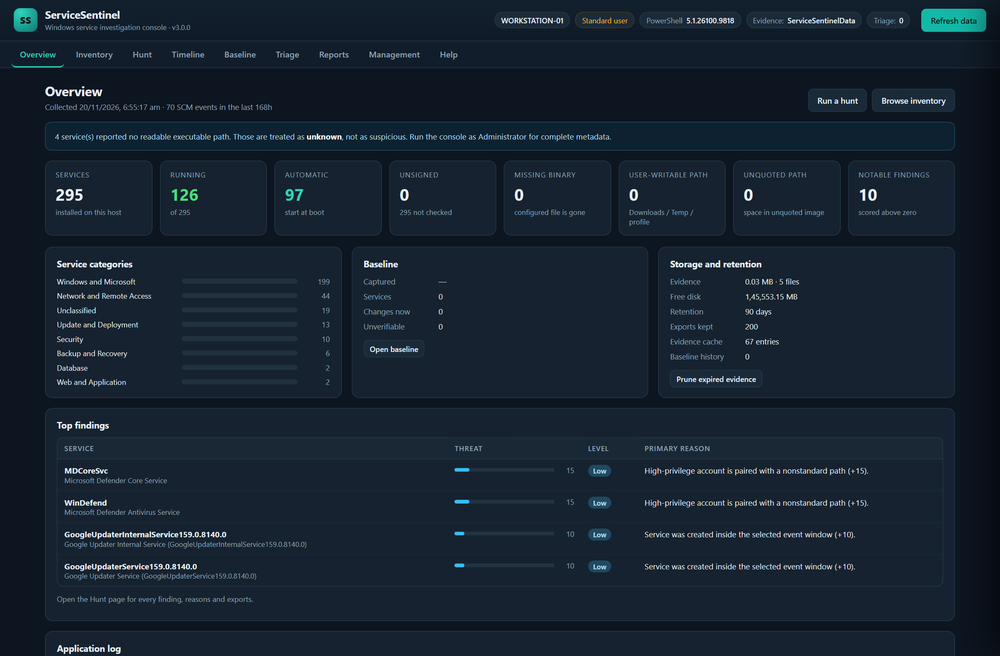
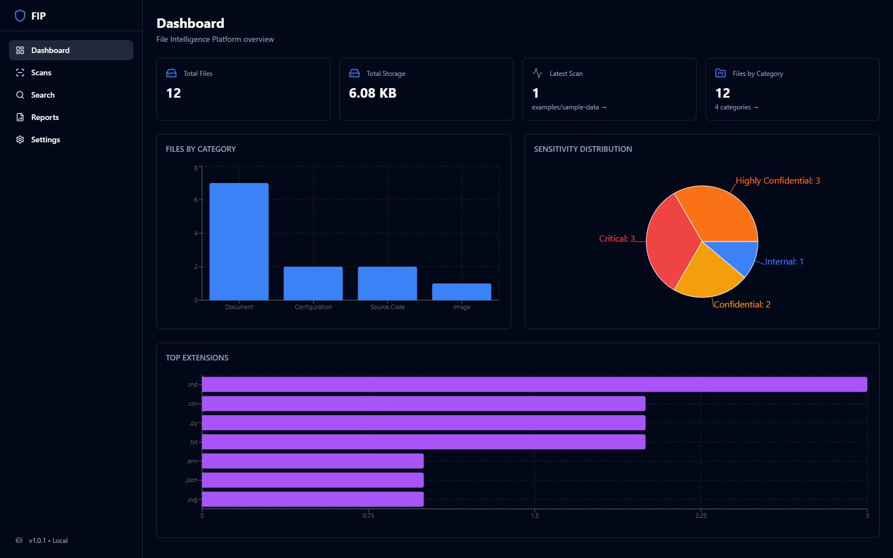
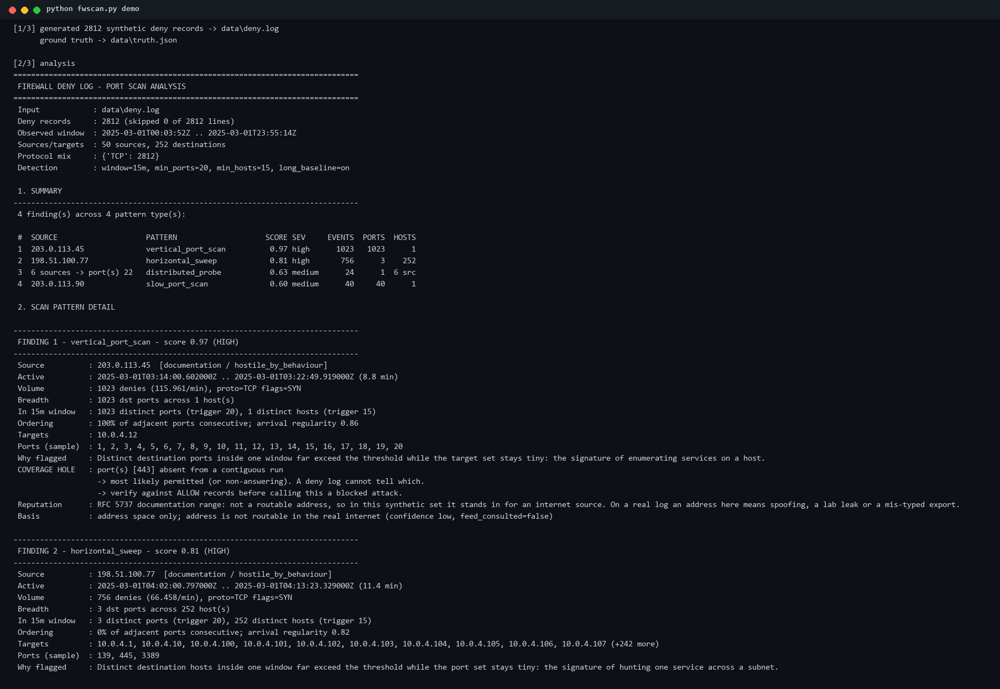
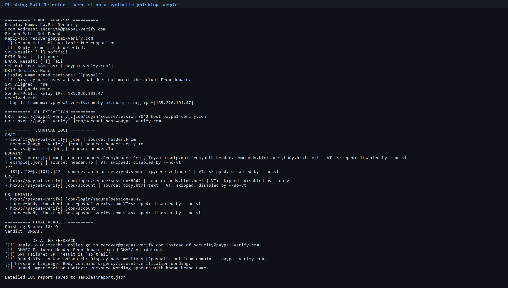

# Security Tools and Prototypes

Defensive tools I built, each answering one question that came up during lab work
or an investigation. They live in one repository because they share the same shape:
one input, one answer, and an honest statement of what the answer cannot tell you.

**The rule:** investigations, labs and the workbench get their own repositories.
Everything else I build — the tools — is indexed here.

None of these is a product. There is no server to deploy, no tenant model, no
telemetry and no claim of production readiness. Most are Python standard library
only, and the ones that are not say so in their own README.

## Tools

One line each. Open a folder for its README and a sample of the tool's real output.

| Tool | What it does |
|---|---|
| **[ServiceSentinel](tools/service-sentinel/)** | Windows service and event-log triage: what is installed, what changed, what looks wrong — and why. |
| **[SOC IR Trainer](tools/soc-ir-trainer/)** | Practise incident response under pressure: 133 scenarios, four roles, a scored debrief. |
| **[File Intelligence Platform](tools/file-intelligence/)** | Inventories a directory and surfaces exposed secrets, personal data and sensitive files. |
| **[FwScan](tools/fwscan/)** | Reads a firewall deny log and separates a broad sweep, a subnet-wide walk and a coordinated scan. |
| **[LogTriage](tools/log-triage/)** | One command that ranks a raw log's findings and lists every indicator, with first and last seen. |
| **[Malware Analyzer CLI](tools/malware-analyzer/)** | The usual file triage in one command: hashes, strings, YARA, PE metadata, optional VirusTotal. |
| **[Phishing Mail Detector](tools/phishing-mail-detector/)** | Reads an `.eml` and flags the header, link and attachment red flags, ending in a verdict. |
| **[ThreatSentry AI](tools/threat-sentry/)** | Prototype that ranks exposed hosts from Shodan and NVD — and is honest about its limits. |
| **[Endpoint Behavior Monitor](tools/endpoint-monitor/)** | A small script showing, at the API level, how keystroke and window telemetry is produced. |

Every tool ships a sample of its real output beside the commands that produced it.
SOC IR Trainer is a practice resource, not an analyser.

## Screenshots

Real output from real runs on this machine, not mockups.

| ServiceSentinel | SOC IR Trainer |
|---|---|
|  |  |

| File Intelligence Platform | FwScan |
|---|---|
|  |  |

| LogTriage | Malware Analyzer CLI |
|---|---|
|  |  |

| Phishing Mail Detector | ThreatSentry AI |
|---|---|
|  |  |

**Endpoint Behavior Monitor** - sample log:


## Why one repository

Each of these started as its own repository. Nine repositories read as noise on a
profile and made every tool harder to find, so they were merged here with their
commit history intact:

```text
git merge -s ours --no-commit --allow-unrelated-histories <tool>/main
git read-tree --prefix=tools/<slug>/ -u <tool>/main
```

Every original commit is reachable in `git log`, and the nine standalone
repositories have been retired in favour of this one. The history is the part
worth keeping, and it is here.

If you followed an old link, the mapping is: `ServiceSentinel` → [`tools/service-sentinel/`](tools/service-sentinel/),
`SOC-IR-Trainer` → [`tools/soc-ir-trainer/`](tools/soc-ir-trainer/),
`File-Intelligence-Platform` → [`tools/file-intelligence/`](tools/file-intelligence/),
`FwScan` → [`tools/fwscan/`](tools/fwscan/),
`LogTriage` → [`tools/log-triage/`](tools/log-triage/),
`Malware_Analyzer_CLI` → [`tools/malware-analyzer/`](tools/malware-analyzer/),
`Advance_Phishing_Mail_Detector_CLI` → [`tools/phishing-mail-detector/`](tools/phishing-mail-detector/),
`ThreatSentry-AI` → [`tools/threat-sentry/`](tools/threat-sentry/),
`Endpoint-Behavior-Monitor` → [`tools/endpoint-monitor/`](tools/endpoint-monitor/).

## What is deliberately not here

The five analyst engines folded into the SecLyst workbench live there and only
there: IOC lookup, malware analysis, phishing analysis, EVTX event analysis and
detection-rule translation. SecLyst is in development and private until that work
settles. RuleForge, the detection-rule workbench from that set, also remains as a
standalone archived repository so its eight-dialect translation stays directly
reachable.

## Limits that apply to all of them

- Each tool answers a narrow question about one input. None of them detects "an
  incident", and none replaces reading the evidence.
- No CI runs at this root. The per-tool workflow files came along in the merge but
  only execute from a repository root, so treat the test claims in each tool's
  README as something to run yourself.
- A few tools call external services (VirusTotal, Shodan). Without keys they fall
  back to offline checks, and the verdicts are weaker for it.
- Quality varies with age. The 2025 scripts were learning work; the newer tools
  have tests.
- The problem definitions, detection logic and every limitation written above are mine.

## Licence

MIT. See `LICENSE`.

Part of my [SOC and detection portfolio](https://github.com/EclipseManic).
