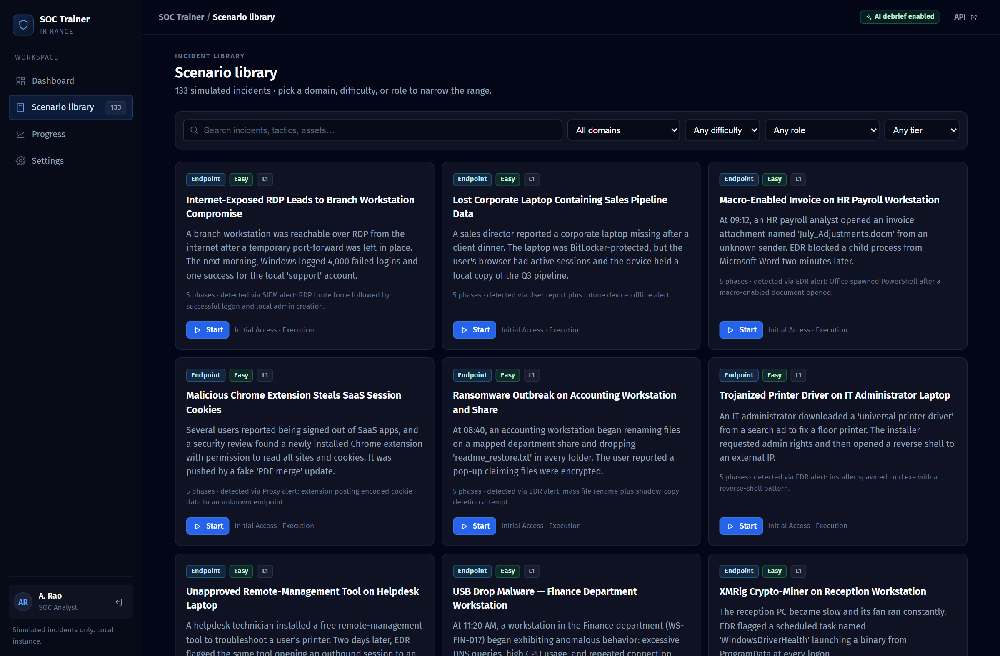
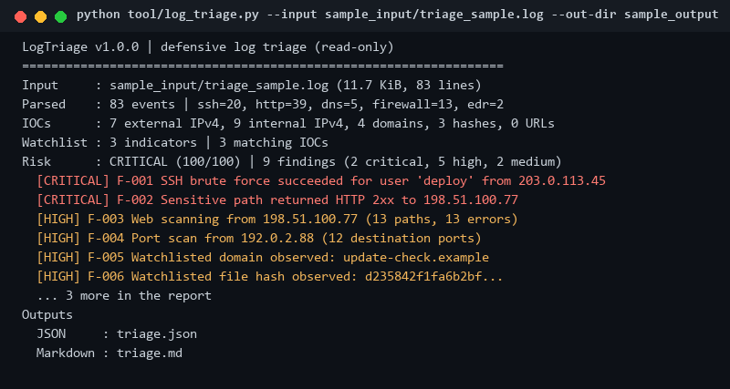

# Security Tools and Prototypes

Defensive tools I built, each answering one question that came up during lab work
or an investigation. They live in one repository because they share the same shape:
one input, one answer, and an honest statement of what the answer cannot tell you.

**The rule:** investigations, labs and the workbench get their own repositories.
Everything else I build — the tools — is indexed here.

None of these is a product. There is no server to deploy, no tenant model, no
telemetry and no claim of production readiness. Most are Python standard library
only, and the ones that are not say so in their own README.

## Tools

Each of these answers one narrow question, and each one gives you the answer *with*
the reasoning behind it — so you can check the call instead of trusting a number.
Open any folder and you get a README plus a committed sample of the tool's real
output.

| Tool | What it does |
|---|---|
| [ServiceSentinel](tools/service-sentinel/) | Windows services are where persistence hides: they start before anyone signs in, run as SYSTEM, and wear ordinary names. ServiceSentinel reads the service control manager and its event log to answer the four questions that matter — what is installed, what changed, what looks wrong, and *why*. Every score is broken into the points behind it, data gaps are shown instead of guessed over, and an unknown service is never quietly called malicious. |
| [SOC IR Trainer](tools/soc-ir-trainer/) | You learn incident response by deciding under pressure, not by reading runbooks. This trainer drops you into a breach that has already happened and makes you choose at each phase, with no feedback until the debrief. Its 133 scenarios span seven domains and four roles — analyst, incident manager, CISO and executive — and score you against the decisions that role actually owns. |
| [FwScan](tools/fwscan/) | A firewall deny log is mostly blocked noise where nothing happened, so the real question is *what kind* of scanning is inside it. FwScan separates a broad sweep, a subnet-wide walk and many sources working together, shows the assumption it made about each source so you can disagree with it, and is honest about what a deny log can never tell you: whether anything actually got through. |
| [LogTriage](tools/log-triage/) | The first pass over a raw log is mechanical — split the formats, separate internal addresses from external, cluster the failures, pull the indicators — and that is exactly why it goes wrong at 3 a.m. Point LogTriage at mixed text and it does that pass for you: ranked findings and every indicator with its first and last time seen, as a Markdown report and a JSON artifact you can attach to a ticket. Read-only, no network, and the judgement stays with you. |
| [Endpoint Behavior Monitor](tools/endpoint-monitor/) | A deliberately small keystroke logger — one file of callbacks that writes every key press and foreground-window change to a text file — kept to show how basic endpoint telemetry is actually produced at the API level. There is no stealth, no persistence and no network code, and it belongs only on a machine you own or are explicitly authorised to monitor. |
| [Malware Analyzer CLI](tools/malware-analyzer/) | A suspicious file means the same handful of checks every time, so this runs them in one command and keeps the output together: hashes, strings, YARA rules and PE metadata offline, then optional VirusTotal, Hybrid-Analysis and MalwareBazaar lookups when you have keys. It ends in a 0–100 risk score and a report for the ticket — a first pass, not a verdict, since every check is one you could have run by hand. |
| [Phishing Mail Detector](tools/phishing-mail-detector/) | Phishing hides in the parts of a mail you never see at a glance. This reads a `.eml` and reports what is underneath: failed SPF/DKIM/DMARC, a Reply-To that does not match the sender, lookalike and punycode domains, risky links, bad attachments, and links buried inside QR-code images. It ends in a verdict — SAFE, CAUTIOUS or UNSAFE — but always shows the indicators behind it, because the score is a reading aid, not a guarantee. |
| [File Intelligence Platform](tools/file-intelligence/) | Nobody knows what is really on a file server until someone looks. Point FIP at a directory and it builds a searchable catalog of what is there — metadata, hashes, extracted text, categories and duplicate groups — then flags content that should not be sitting in the open: credentials, personal data, cloud keys and private keys, scored 0–100 against 40+ patterns. It runs entirely on your machine against files you already have, with a small web UI and scans you can pause, resume or cancel. |
| [ThreatSentry AI](tools/threat-sentry/) | An early prototype of asset prioritisation: pull exposed-host data from Shodan, enrich it with NVD records, score it, and produce a ranked queue that shows the reasoning behind each position. It is honest about its own edges too — the ML is trained on synthetic data, the internal CMDB/SIEM/patch collectors are stubs, and live data needs a Shodan key — so the ranking is a starting point for triage, never an assessment you hand to someone else. |

Every tool commits a sample of its real output next to the commands that produced
it, so you can reproduce the result rather than take it on faith. The endpoint log
is synthetic on purpose: recording real keystrokes is not something to demonstrate.
SOC IR Trainer is a practice resource rather than an analyser — it lives here only
so everything I build is found in one place.

## Screenshots

Real output from real runs on this machine, not mockups.

| ServiceSentinel | SOC IR Trainer |
|---|---|
|  |  |

| FwScan | LogTriage |
|---|---|
|  |  |

| Malware Analyzer CLI | Phishing Mail Detector |
|---|---|
|  |  |

| Endpoint Behavior Monitor | File Intelligence Platform |
|---|---|
|  |  |

**ThreatSentry AI** - main hunting interface:


## Why one repository

Each of these started as its own repository. Nine repositories read as noise on a
profile and made every tool harder to find, so they were merged here with their
commit history intact:

```text
git merge -s ours --no-commit --allow-unrelated-histories <tool>/main
git read-tree --prefix=tools/<slug>/ -u <tool>/main
```

Every original commit is reachable in `git log`, and the nine standalone
repositories have been retired in favour of this one. The history is the part
worth keeping, and it is here.

If you followed an old link, the mapping is: `FwScan` → [`tools/fwscan/`](tools/fwscan/),
`LogTriage` → [`tools/log-triage/`](tools/log-triage/),
`Endpoint-Behavior-Monitor` → [`tools/endpoint-monitor/`](tools/endpoint-monitor/),
`Malware_Analyzer_CLI` → [`tools/malware-analyzer/`](tools/malware-analyzer/),
`Advance_Phishing_Mail_Detector_CLI` → [`tools/phishing-mail-detector/`](tools/phishing-mail-detector/),
`File-Intelligence-Platform` → [`tools/file-intelligence/`](tools/file-intelligence/),
`ThreatSentry-AI` → [`tools/threat-sentry/`](tools/threat-sentry/),
`ServiceSentinel` → [`tools/service-sentinel/`](tools/service-sentinel/),
`SOC-IR-Trainer` → [`tools/soc-ir-trainer/`](tools/soc-ir-trainer/).

## What is deliberately not here

The five analyst engines folded into the SecLyst workbench live there and only
there: IOC lookup, malware analysis, phishing analysis, EVTX event analysis and
detection-rule translation. SecLyst is in development and private until that work
settles. RuleForge, the detection-rule workbench from that set, also remains as a
standalone archived repository so its eight-dialect translation stays directly
reachable.

## Limits that apply to all of them

- Each tool answers a narrow question about one input. None of them detects "an
  incident", and none replaces reading the evidence.
- No CI runs at this root. The per-tool workflow files came along in the merge but
  only execute from a repository root, so treat the test claims in each tool's
  README as something to run yourself.
- A few tools call external services (VirusTotal, Shodan). Without keys they fall
  back to offline checks, and the verdicts are weaker for it.
- Quality varies with age. The 2025 scripts were learning work; the newer tools
  have tests.
- The problem definitions, detection logic and every limitation written above are mine.

## Licence

MIT. See `LICENSE`.

Part of my [SOC and detection portfolio](https://github.com/EclipseManic).
