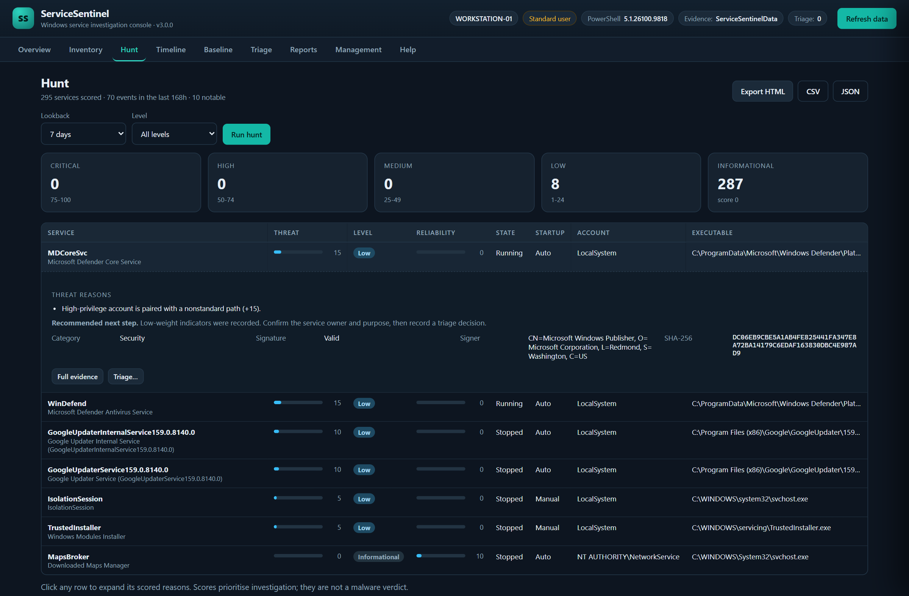
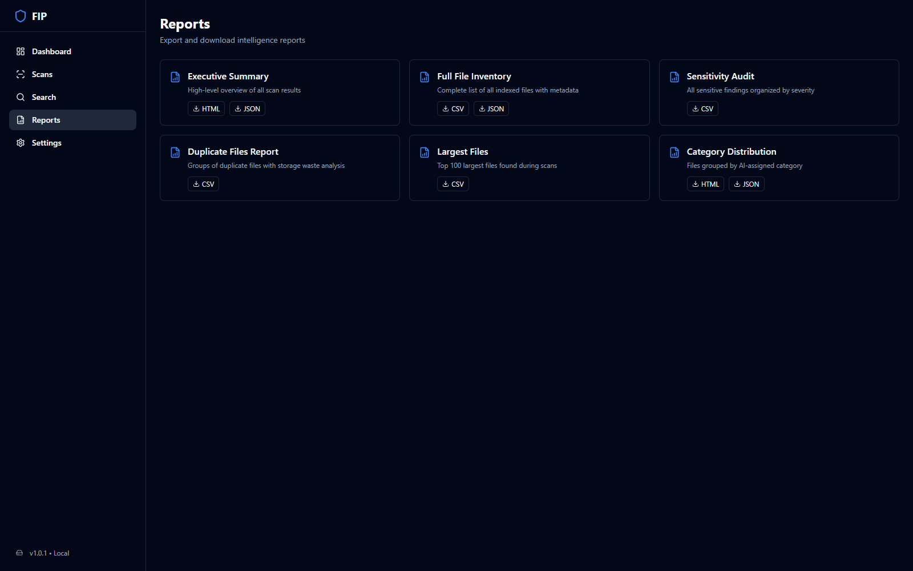

# ServiceSentinel

**A local-first investigation console for Windows services.**

[](https://github.com/EclipseManic/ServiceSentinel/actions/workflows/tests.yml)
[](https://www.python.org/)
[](LICENSE)

Windows services are where persistence lives: they start before a user signs in, run
under privileged accounts, and are easy to disguise. ServiceSentinel turns the service
control manager and its event log into a defensible investigation: what is installed,
what changed, what looks wrong, and why.

It is **not** a malware scanner and it does not call the cloud. Every score is
explained, every data gap is visible, and "unknown" is never treated as suspicious.


## What you get

- **Inventory** — every service with image path, account, start mode, signature state,
  and the evidence behind it.
- **Explainable threat scoring** — weighted, per-indicator points that add up to a
  score you can defend in a report.
- **Hunt** — score the whole host over a chosen window and expand each finding for
  reasons, data gaps, and a suggested next step.
- **Service Control Manager timeline** — 7035/7036/7040/7045/7000-series events with
  daily and weekly summaries, including localised state words.
- **Trusted baselines** — snapshot a known-clean host, then review created, deleted,
  changed, rotated, and unverifiable services.
- **Analyst triage** — append-only decisions with a live evidence snapshot attached.
- **Evidence exports** — CSV, JSON, and HTML for inventory, assessment, timeline,
  baseline changes, and triage.
- **Guarded management** — start, stop, restart, change startup type, contain, or
  delete a service with elevation checks, backups, and per-step results.

## Screenshots

| Hunt findings | Evidence exports |
|---|---|
|  |  |

## Quick start

Requirements: Windows, Python 3.10+, and PowerShell 5.1 or 7 (used only as a data
collector).

```powershell
git clone https://github.com/EclipseManic/servicesentinel.git
cd servicesentinel
python -m venv .venv
.venv\Scripts\Activate.ps1
pip install -r requirements.txt
python run.py
```

`run.py` opens `http://127.0.0.1:8765/` and prints the evidence path. It serves the
app with **waitress**, not the Flask development server.

Run from an **elevated prompt** for complete metadata. Without elevation the console
still works, but Windows hides the binary path, account, and type of some protected
services; those are reported as *unknown* instead of guessed.

| Option | Meaning |
|---|---|
| `--port 9000` | Listen on another port (default 8765) |
| `--password "..."` | Require this password before the console opens |
| `--host 0.0.0.0` | Bind beyond localhost; requires `--allow-remote` **and** `--password` |
| `--workers 8` | waitress worker threads (default 4) |
| `--retention-days 30` | Delete reports and logs older than this (default 90) |
| `--no-browser` | Do not open a browser |
| `--data-dir D:\evidence` | Store logs, baselines, and exports somewhere else |
| `--server dev --debug` | Flask development server with the reloader (debugging only) |

The server binds to `127.0.0.1` by default and refuses a non-loopback bind unless a
password is configured. Mutating requests require a per-session token that the page
carries in an `X-Sentinel-Token` header, so another website open in your browser cannot
drive service management.

## Pages

| Page | What it does |
|---|---|
| **Overview** | Host posture: counts, category distribution, baseline age, top findings, application log |
| **Inventory** | Search and filter every service; sortable table; full evidence drawer per service |
| **Hunt** | Score all services over a chosen window; expand any finding for reasons, data gaps, and next step |
| **Timeline** | SCM events (7035/7036/7040/7045/7000-series) with daily or weekly summaries |
| **Baseline** | Create a trusted snapshot, compare now against it, review unverifiable values and history |
| **Triage** | Record Investigate / Monitor / Allow / Contain / FalsePositive / Resolved with a live evidence snapshot |
| **Reports** | Export inventory, assessment, timeline, baseline changes, or triage as CSV, JSON, or HTML |
| **Management** | Start, stop, restart, change startup type, contain, or delete a service, with per-step results |
| **Help** | The methodology, scoring table, localisation handling, and limitations |

## Why unknown is not suspicious

Windows hides metadata from non-elevated callers. A security tool that scores missing
data will always produce findings it cannot justify. The console therefore separates
three states for every field:

- **checked and clean** — evidence exists and is compared or scored;
- **checked and bad** — evidence exists and contributes points;
- **could not check** — reported as a data gap with zero points, and the UI asks you to
  re-run elevated.

This is the most important design rule in the project. A clean score does not prove a
service is benign; it means the checks that could run found nothing.

## Threat scoring

Every point is explained in the interface, so a score can always be reconstructed.

| Indicator | Points |
|---|---:|
| Executable in a user-writable or temporary location | +40 |
| Windows component name impersonation from a non-System32 path | +35 |
| Invalid signature (`HashMismatch`, `NotTrusted`, `UnknownError`) | +30 |
| Script or proxy-execution host (`powershell`, `cmd`, `mshta`, `rundll32`, …) | +25 |
| Configured executable is missing | +20 |
| Unquoted executable path containing spaces | +20 |
| Executable outside Windows and Program Files | +15 |
| Executable not digitally signed | +15 |
| SYSTEM/LocalSystem paired with a non-standard path | +15 |
| Automatic startup from a user-writable location | +10 |
| Service created inside the event window | +10 |
| Startup type changed inside the event window | +5 |

Levels: **Critical** 75–100, **High** 50–74, **Medium** 25–49, **Low** 1–24,
**Informational** 0. Scores prioritise investigation; they are not a malware verdict.

Reliability is scored separately and capped: unexpected stops 10 each (max 40), other
failure or timeout events 5 each (max 30). A crash loop is an availability problem, not
maliciousness.

## Baselines

A baseline records name, display name, state, startup mode, account, service type,
command line, and executable path. Comparisons report:

- services **created** or **deleted** since the snapshot;
- **configuration changes** to command line, account, startup mode, display name, or type;
- **versioned replacements** (same service family, new version-stamped name) as `Low`;
- **unverifiable** values that were readable in only one snapshot.

Create a baseline only when the computer is known to be clean — otherwise existing
persistence becomes part of the trusted reference.

## Management safety

Every action requires the exact service name, case-sensitively. `Contain` and `Delete`
write a JSON configuration backup first; `Contain` can be undone from the backup table.
Dependent services are shown before any disruptive action. Core operating-system
services are refused outright. Partial failures are reported per step and never reported
as success.

## Security model

| Control | Behaviour |
|---|---|
| Transport | Plain HTTP on loopback by default; add TLS (reverse proxy) before any remote use |
| Sessions | Signed cookie, `HttpOnly`, `SameSite=Strict`, 8-hour lifetime, key persisted with `0600` under the evidence folder |
| CSRF | Every mutating request needs the per-session `X-Sentinel-Token` header |
| Headers | Strict CSP (`default-src 'self'`), `X-Frame-Options: DENY`, `nosniff`, `no-referrer`, `Cache-Control: no-store` |
| Input limits | 1 MB request cap; download paths validated; export formats and report names allow-listed |
| Exports | CSV cells starting with `= + - @` are quoted to stop spreadsheet formula injection; HTML output is escaped |
| Management | Elevation check, exact case-sensitive name confirmation, core services refused, configuration backup before disruptive actions, per-step results, rollback and delete verification |
| Egress | None. No telemetry, no reputation lookups, no outbound calls of any kind |

Failed logins are rate limited (8 attempts, then a 60-second lockout) and written to
the application log. `GET /api/health` is unauthenticated and returns `200 ok` or
`503 degraded` with component checks.

Details, threat model, and a deployment checklist: [SECURITY.md](SECURITY.md).

## Evidence and privacy

Everything is written under `ServiceSentinelData/` beside the project (falling back to
`%LOCALAPPDATA%\ServiceSentinel` if the project folder is not writable):

```
ServiceSentinelData/
  ServiceSentinel_YYYYMMDD.log      application log
  baseline-latest.json              current trusted snapshot
  baseline_YYYYMMDD_HHMMSS.json     history
  triage_decisions.jsonl            append-only analyst decisions
  containment_backups/              pre-change configuration
  cache/file-evidence.json          signature + hash cache keyed by size/mtime
  cache/state-words.json            learned localised service states
  inventory_* / assessment_* ...    exported reports
```

These files contain hostnames, paths, hashes, and analyst notes. They are excluded by
`.gitignore`. Nothing is sent anywhere: there is no VirusTotal or cloud lookup.

## Testing

```powershell
pip install -r requirements-dev.txt
python -m pytest -q
```

The suite has **70 unit and API tests** covering scoring, category weighting, baseline
diffing and rotation, timeline parsing, CSV injection, retention, authentication, CSRF,
and management safety. CI runs it on `windows-latest` with Python 3.10, 3.12, and 3.13.

## Project layout

```
run.py                      launcher and CLI
sentinel/
  config.py                 version, paths, evidence root resolution
  storage.py                atomic JSON, JSONL append, application log
  paths.py                  path parsing, user-writable/protected root logic
  analysis.py               categories, event interpretation, scoring, summaries
  baseline.py               capture, diff, rotation detection
  triage.py                 append-only analyst decisions
  collector.py              PowerShell collection with a thread-safe cache
  server.py                 Flask app, authentication, CSRF, security headers
  ps/collect.ps1            read-only Windows data collector
  static/                   single-page console (no build step)
  templates/                shell and login page
tests/                      pytest suite
docs/DESIGN-NOTES.md        evidence model and rewrite decisions
```

## Documentation

- [SECURITY.md](SECURITY.md) — threat model, controls, vulnerability reporting.
- [docs/DESIGN-NOTES.md](docs/DESIGN-NOTES.md) — why unknown is not suspicious and
  what the rewrite changed.
- [CHANGELOG.md](CHANGELOG.md) — release history.

## Limitations

- Scores are heuristics, not malware verdicts.
- ServiceDll values and full executable ACLs are not audited.
- Event visibility depends on the host's audit policy and log retention.
- Management is Windows-only, requires elevation, and refuses core services by design.
- There is no demo mode: the console reports the real host it runs on.

## Running it for a team

A service console is a privileged tool. Treat it like one:

1. **Credentials.** Set `--password` (or `SENTINEL_PASSWORD`) whenever more than one
   person can reach the host, and always when binding beyond localhost.
2. **Network exposure.** Keep the default loopback bind. To reach it from another
   machine, use a host firewall rule for specific admin subnets or tunnel it over SSH.
3. **Least privilege.** Run as administrator only on hosts where you are authorised to
   change service state.
4. **Evidence handling.** `ServiceSentinelData/` contains host evidence. Do not commit
   it or copy it to an untrusted share.
5. **Retention.** Expired reports, logs, and baseline history are pruned at every start
   and on demand from the Overview page. The current baseline, the triage log, and
   containment backups are never deleted automatically.

## Ethical use

Use ServiceSentinel only on systems you own or are explicitly authorised to inspect.
Service management can disrupt a production host; verify business impact before
stopping, containing, or deleting anything.

## License

MIT — see [LICENSE](LICENSE). Copyright (c) 2026 Eclipsemanic.

Part of my [SOC and detection portfolio](https://github.com/EclipseManic). See also [Security-Tools-and-Prototypes](https://github.com/EclipseManic/Security-Tools-and-Prototypes) for smaller service and log utilities.
