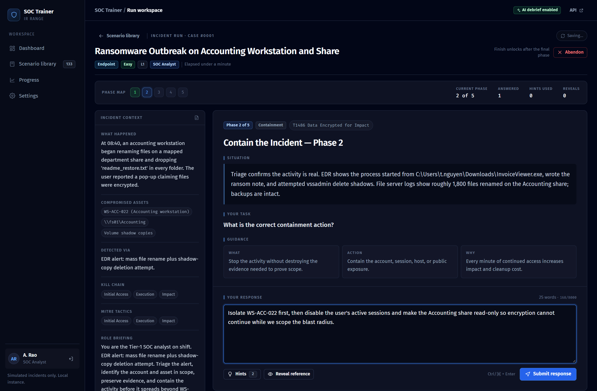
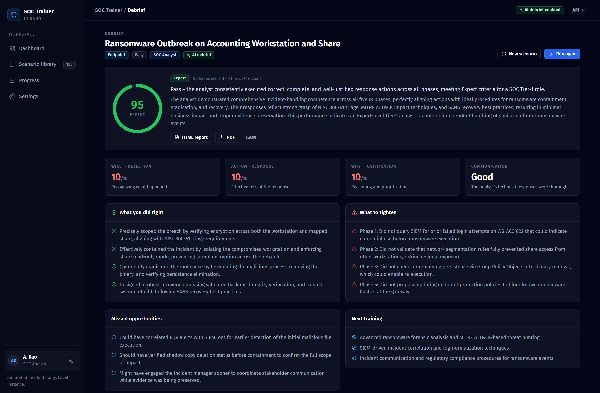

# SOC IR Trainer

**A local, browser-based incident-response trainer for SOC analysts.**

[](https://github.com/EclipseManic/SOC-IR-Trainer/actions/workflows/tests.yml)
[](https://www.python.org/)
[](LICENSE)

SOC work is learned by making decisions, not by reading runbooks. SOC IR Trainer
puts you inside a breach that has already happened: you get the detection, the
assets, and the pressure, then you choose what to do next. Every scenario is a
short incident with four to six response phases and a detailed debrief at the
end.

There is no feedback while the incident is live. You commit to an answer, move
on, and find out how you did when the run is finished — the same way a real
investigation unfolds.

> **Simulation only.** Scenario content is fictional. No exploits are executed.
> Nothing you type is used against a real system.


## What you get

- **133 incident scenarios** across seven domains, with **51 Easy** entries for
  first-time analysts and a progression up to Expert and Critical.
- **Four roles** — SOC Analyst, Incident Manager, CISO, and Executive. The same
  incident is judged against the decisions that role actually owns.
- **Free-text at every phase** in the browser and the terminal. Typed answers
  are scored against the scenario's reference concepts.
- **No feedback during the run.** Phases advance without revealing whether an
  answer was right.
- **Hints and reference reveals** that are recorded and counted in the debrief.
- **One AI debrief at the end**, or a deterministic offline debrief when no API
  key is configured.
- **Per-phase scoring** for what you did, why you did it, and how you
  communicated it, plus strengths, gaps, missed opportunities, and next-training
  recommendations.
- **Reports** in HTML, PDF, and JSON.
- **Progress tracking** across domains and MITRE techniques, with a score trend
  and run history.
- **Resumable runs** — answers and drafts survive a refresh or restart.

## Scenario library

| Domain | Scenarios | Sample topics |
|---|---:|---|
| Endpoint | 27 | Macro documents, ransomware, rogue RMM, lost laptops, fake drivers |
| Identity & Access | 25 | Password spraying, MFA fatigue, leaked keys, OAuth consent abuse |
| Web App | 22 | SQL injection, XSS, exposed backups, vulnerable plugins, CORS |
| Cloud | 16 | Public object storage, wildcard IAM, leaked deploy keys, mailbox rules |
| Advanced Threats | 19 | Supply-chain compromise, canary tokens, credential dumps, sideloading |
| Network | 14 | Rogue Wi-Fi, DNS beaconing, rogue DHCP, VPN brute force, Tor egress |
| AI & ML | 10 | Prompt injection, exposed model keys, poisoned RAG content |

Every scenario ships with a narrative briefing, compromised assets, detection
source, MITRE ATT&CK tactics, and phase-level technique references.

| Run workspace | AI debrief |
|---|---|
|  |  |

## Quick start

Requirements: **Python 3.11+**, **Node.js 18+** (only to build the browser app),
and a modern browser.

```powershell
git clone https://github.com/EclipseManic/soc-ir-trainer.git
cd soc-ir-trainer
python -m venv .venv
.venv\Scripts\Activate.ps1
pip install -r requirements.txt
python start.py
```

`start.py` installs any missing Python packages, installs the frontend
dependencies, builds the React app when needed, starts the API and GUI at
<http://127.0.0.1:8765/>, and opens your browser. Later runs skip work that is
already up to date.

```bash
python start.py --port 9000      # different port
python start.py --no-browser     # do not open a browser
python start.py --build always   # force a frontend rebuild
python start.py --db mydata.db   # use a different session database
python start.py --no-install     # never run pip or npm
python start.py --help
```

The server binds to loopback only. `--host` requires `--allow-lan`, and the app
is a single-user local tool, so do not expose it to an untrusted network.

### AI debrief (optional)

Add an OpenRouter key in **Settings**, or set it before starting:

```powershell
$env:OPENROUTER_API_KEY = "sk-or-v1-..."
python start.py
```

Get a key at <https://openrouter.ai/keys>. Free models work. Without a key the
trainer still runs and produces the offline debrief, which scores concept
coverage per phase and explains what a strong answer would have included.

The key is written to `.env` (gitignored) and never returned to the browser.
The Settings page exposes only whether a key is configured.

### Terminal CLI

The original terminal trainer is still available:

```bash
python main.py
```

It offers the same scenario library, role selection, adaptive recommendations,
scenario generation with an AI key, and HTML/PDF/JSON reports.

## How a run works

1. **Create a profile** and choose a role and the domains you want to train.
2. **Pick a scenario** from the library; filter by domain, difficulty, tier, or
   search text.
3. **Read the briefing** — what happened, which assets are involved, how it was
   detected, and the MITRE tactics in play.
4. **Work the phases.** Each phase shows the current situation, the relevant
   technique, and a free-text box. Hints and the reference answer are available
   but are recorded.
5. **Finish the run.** The API queues a background evaluation. With AI enabled,
   the whole session is sent once to the selected OpenRouter model. Without a
   key, the offline scorer produces the debrief immediately.
6. **Read the debrief** — total score and grade, per-phase correctness for
   action and reasoning, strengths, gaps, communication feedback, timeline
   guidance, and suggested next scenarios.
7. **Download a report** in HTML, PDF, or JSON, and track the result on the
   Progress page.

## Testing

```bash
pip install -r requirements-dev.txt
python -m pytest -q
```

The suite has **72 tests** covering the scenario loader and content schema, the
offline concept scorer, MITRE matching, adaptive recommendations, the session
database, the AI fallback path, and API contracts such as CSRF and secret
handling. CI runs it on Ubuntu and Windows with Python 3.11 and 3.13, and
separately type-checks and builds the frontend.

An optional end-to-end exercise drives a full scenario, the AI path, and report
generation:

```bash
python tests/manual_e2e.py
```

It writes only to temporary directories and cleans up after itself.

## Project layout

```
soc-ir-trainer/
├── start.py                 # One-command launcher: deps, build, serve
├── main.py                  # Terminal trainer
├── config.py                # Paths, model settings, key persistence, branding
├── api/                     # FastAPI service
│   ├── app.py               # App factory, CSP, CSRF, SPA hosting
│   ├── auth.py              # Signed-cookie profile session
│   ├── routes.py            # /api/v1 endpoints
│   ├── jobs.py              # Background evaluation jobs
│   └── schemas.py           # Pydantic response models
├── core/
│   ├── run_service.py       # Run state machine shared by CLI and API
│   ├── session_db.py        # SQLite profiles, runs, answers, evaluations
│   ├── ai_evaluator.py      # OpenRouter call, lenient JSON parser, fallback
│   ├── response_scorer.py   # Offline concept-coverage scorer
│   ├── reporter.py          # HTML, PDF, and JSON reports
│   ├── sim_engine.py        # Terminal phase loop
│   ├── adaptive.py          # Next-scenario recommendations
│   ├── mitre.py             # ATT&CK technique matching
│   └── scenario_generator.py # Optional AI scenario generation (CLI)
├── scenarios/
│   ├── loader.py            # YAML loader and validation
│   ├── base.py              # Scenario, Phase, choice models
│   └── data/                # 133 scenarios in seven domain folders
├── web/                     # React + Vite browser GUI
│   └── src/                 # Dashboard, library, run workspace, debrief
├── tests/                   # pytest suite + optional manual E2E
├── docs/                    # Architecture notes and screenshots
└── reports/                 # Generated reports (gitignored)
```

## Configuration

| Variable | Default | Purpose |
|---|---|---|
| `OPENROUTER_API_KEY` | unset | Enables the AI debrief and scenario generation |
| `OPENROUTER_MODEL` | `nvidia/nemotron-3.5-lightning:free` | Any OpenRouter model id |
| `OPENROUTER_TIMEOUT` | `180` | Seconds before the AI call aborts |
| `OPENROUTER_TEMPERATURE` | `0.3` | Lower is more consistent |
| `SOC_AI_DISABLED` | `0` | Set to `1` to force the offline debrief |
| `SOC_SESSION_SECRET` | generated | Overrides the local cookie-signing secret |
| `SOC_TRAINER_DB` | `sessions.db` | Session database path |
| `SOC_COOKIE_SECURE` | `0` | Set to `1` when serving over HTTPS |
| `SOC_DEV_CORS` | `0` | Allow the Vite dev server on port 5173 |

The model can also be chosen in Settings from the live OpenRouter catalog.

## Privacy and AI egress

Everything is local: profiles, runs, answers, drafts, evaluations, and reports
live in `sessions.db` and `reports/`. There is no telemetry.

When AI is enabled, finishing a run sends **one** request to OpenRouter. It
contains the incident title, category, summary, phase prompts, your responses,
your role, hint usage, reference lookups, and the offline score. It does **not**
contain your API key, local paths, hostnames, or the session database. Opening
the model picker fetches the public OpenRouter catalog. If you do not want any
egress, leave the key unset.

Treat `sessions.db`, `.env`, `.session_secret`, and `reports/` as sensitive.
They contain profile names and everything you typed. All are gitignored.

## Limitations

- This is **training content**, not an incident-response playbook. Real incidents
  are messier and rarely match a scripted phase.
- The offline debrief is a concept-coverage heuristic. It is consistent and
  explainable, but it is not a human grade.
- AI feedback depends on the selected model and can be wrong, inconsistent, or
  rate-limited. Free models are slower and may be retired.
- There is no password and no multi-user isolation. Run it locally, for one
  analyst at a time.
- Scenario generation is a CLI feature and requires an AI key. Generated content
  should be reviewed before it is used for training.

## Ethical use

Use this trainer for education and authorised practice only. Scenario content is
fictional and deliberately avoids real exploit code. Do not treat any suggested
action in a debrief as authorisation to act on a live system.

## License

MIT. Copyright (c) 2026 Eclipsemanic. See [LICENSE](LICENSE).
