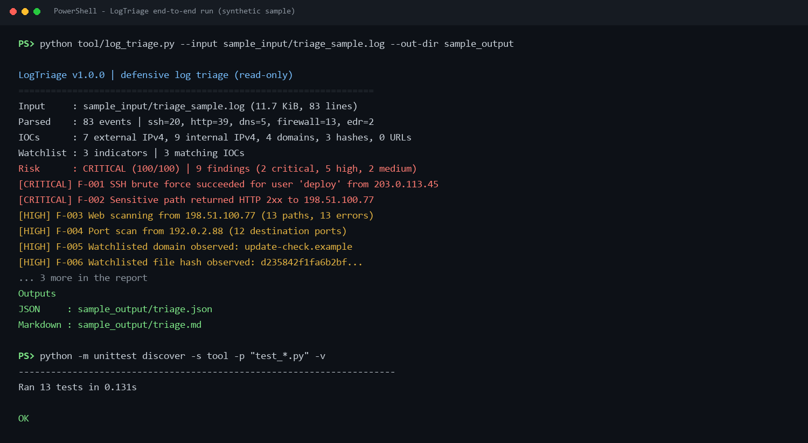
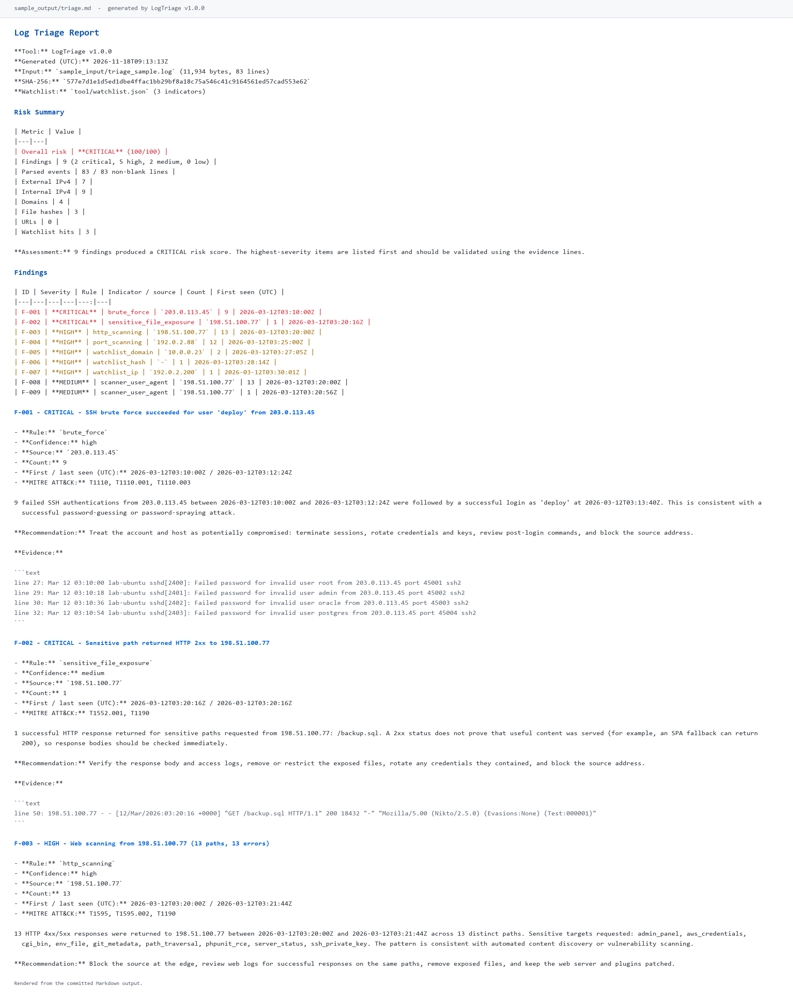
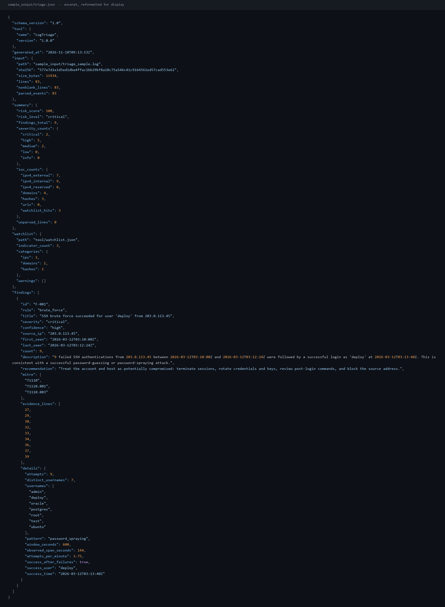

# LogTriage — walkthrough of the committed sample run

This is a read-through of what LogTriage produces on
`sample_input/triage_sample.log`: what fired, why it fired, and which findings
would need tuning before the tool saw real data. The reports it describes are
committed in [`../sample_output/`](../sample_output/), and the input is
synthetic and regenerable, so every number below is reproducible.

## What the run does

Ingest a mixed text log, extract IPv4/domain/URL/hash indicators, correlate
suspicious behaviour such as brute force and scanning, and emit a structured
Markdown + JSON summary. The goal is to shorten the first-pass triage loop while
keeping the analyst in control of validation.

## Environment

- Run against a local file on an isolated machine. **Synthetic data only**,
  generated by `sample_input/generate_sample.py`.
- The sample log uses RFC 5737 documentation addresses, RFC 1918 private
  addresses, reserved `.example` domains, invented users and hosts, and hashes
  of fixed demo strings.
- No real company data, PII, secrets, API keys, or live systems are involved.
- The tool is defensive and read-only. It does not target, scan, or modify any
  remote system.

## Design

**Inputs**

- Text logs: OpenSSH auth logs, Apache/Nginx combined access logs, dnsmasq query
  logs, UFW/iptables block lines, and ISO-8601 endpoint/EDR lines.
- Optional local JSON watchlist (`tool/watchlist.json` by default).
- Optional INI configuration file (`tool/tool.config`) covering every runtime
  flag; command-line flags override file values.
- CLI thresholds with safe defaults (20-second correlation window, 5 failed SSH
  logins, 10 HTTP errors, 8 distinct blocked ports; a successful login within
  5 minutes of a burst is treated as critical).

**Outputs**

- `sample_output/triage.json` — structured summary with metadata, risk score,
  findings, grouped IOCs, evidence line numbers, timeline, stats, and
  limitations.
- `sample_output/triage.md` — human-readable report with risk summary, detailed
  findings, IOC tables, timeline, detection logic, and assumptions.

**Flow**

```text
tool/tool.config + CLI flags
   |
   v
input log
   |
   v
ingest -> tolerant line parser (SSH / HTTP / DNS / firewall / EDR / generic)
   |
   v
IOC extraction and scope classification (IPv4, domains, URLs, hashes)
   |
   v
behavioural detectors
  - SSH failures clustered per source, success-after-burst check
  - HTTP 4xx/5xx clustered per source, distinct + sensitive paths
  - HTTP 2xx on sensitive paths
  - firewall blocks clustered by destination port
  - offensive scanner user-agents
  - local watchlist matches
   |
   v
severity weights -> 0-100 risk score -> sorted findings
   |
   v
JSON + Markdown reports and console summary
```

**Safety guards**

- Read-only: input is never modified; no shell execution; no network requests.
- No attacking capability and no target selection.
- 50 MiB input cap and 10,000-character line cap to bound memory/abuse.
- All log content is escaped or truncated before Markdown rendering.
- Watchlist and sample data are synthetic; no secrets or PII.

**Dependencies**

Python 3.10+ standard library only. `tool/requirements.txt` intentionally
contains no packages.

## How to run it

From the repository root:

```bash
python -m pip install -r tool/requirements.txt
python tool/log_triage.py --input sample_input/triage_sample.log --out-dir sample_output
```

Expected console result: `CRITICAL (100/100)`, 9 findings, with JSON and
Markdown written to `sample_output/`.

Runtime defaults live in `tool/tool.config` (INI). Edit that file to change
detection thresholds, output paths, watchlist behaviour, and reporting without
touching code; command-line flags override it. Use `--config PATH` to load a
different configuration file.

Useful variants:

```bash
# JSON only, lower brute-force threshold, fail CI on high risk
python tool/log_triage.py -i sample_input/triage_sample.log --format json \
  --brute-threshold 4 --fail-on high

# Unit tests
python -m unittest discover -s tool -p "test_*.py" -v
```

## Results

The tool parsed all 83 non-blank lines and produced **9 findings** with a risk
score of **100/100 (CRITICAL)**:

1. **Critical — SSH brute force succeeded.** 9 failed logins from
   `203.0.113.45` across 7 usernames (`root`, `admin`, `oracle`, `postgres`,
   `test`, `ubuntu`, `deploy`) between 03:10:00 and 03:12:24, followed by a
   successful login as `deploy` at 03:13:40.
2. **Critical — sensitive file exposure lead.** `198.51.100.77` received
   `200 OK` for `/backup.sql` after a scanning burst. The report correctly
   labels this as requiring response-body validation.
3. **High — web scanning.** 13 HTTP errors across 13 distinct paths, including
   `/.env`, `/.git/config`, `/phpmyadmin/`, `/.aws/credentials`, and a path
   traversal attempt.
4. **High — port scanning.** 12 blocked connections from `192.0.2.88` across
   12 destination ports in 44 seconds.
5. **High — watchlist hits.** The synthetic watchlist matched a C2 IP
   (`192.0.2.200`), a malware-update domain (`update-check.example`), and a
   SHA-256 file hash on an EDR quarantine event.
6. **Medium — scanner user-agents.** Nikto and sqlmap signatures were extracted
   from the web requests.

IOC inventory: 7 external IPv4 addresses, 9 internal addresses (context only),
4 domains, 3 hashes (one watchlisted, two benign/clean), and 0 URLs.

## Artifacts

- Command and console summary: 
- Rendered Markdown triage report: 
- JSON structure and first finding: 
- Raw outputs: [`../sample_output/triage.md`](../sample_output/triage.md),
  [`../sample_output/triage.json`](../sample_output/triage.json)
- Automated checks: 18 tests pass with
  `python -m unittest discover -s tool -p "test_*.py" -v`.

## Reading the findings critically

- The score of 100 is a weight sum, not a probability. Three independent
  critical-class signals in one small log will always saturate it.
- The brute-force finding is the strongest: failures then a success from the
  same source inside the success window is the pattern that actually means
  something.
- The `/backup.sql` 200 is the weakest of the critical pair. Without the
  response body it is a lead. A single-page app returning 200 for every path
  would produce the same evidence.
- Port-scan severity depends on estate context. A 12-port sweep from a
  documentation address in a lab is noise; from an external address against a
  production edge it is not.

## Known limits

- Thresholds are static; production use needs per-host baselining and
  allowlists for known scanners and automation.
- Correlation is limited to one file and one process run; events are held in
  memory.
- Syslog timestamps lack a year; `--assume-year` is required for deterministic
  results across years.
- A 2xx response for a sensitive path can be a false positive (for example, an
  SPA catch-all); response-body validation is intentionally out of scope.
- IPv6 and non-text/compressed logs are not fully supported.
- The JSON report is a triage artifact, not a STIX/TAXII export.

## Where it would go next

An offline enrichment layer: a second "known-good" allowlist plus a local
threat-intel cache, support for gzip/rotated logs, and a compact ATT&CK coverage
view. That would cut false positives and make the tool practical over a week of
lab logs without changing its read-only safety model.

## References

All references are public; no data is downloaded at runtime. Full list:
[`../sources/links.md`](../sources/links.md).

- MITRE ATT&CK T1110 Brute Force and T1110.003 Password Spraying
- MITRE ATT&CK T1595.002 Vulnerability Scanning and T1046 Network Service Discovery
- MITRE ATT&CK T1552.001 Credentials In Files
- RFC 5737 (IPv4 documentation ranges), RFC 1918 (private addressing), RFC 2606
  (reserved `.example` domains)
- Python 3 standard library documentation (`hashlib`, `ipaddress`, `json`,
  `argparse`)
- OWASP Logging Cheat Sheet and Nginx access-log documentation

The sample log was generated locally by
[`../sample_input/generate_sample.py`](../sample_input/generate_sample.py).
