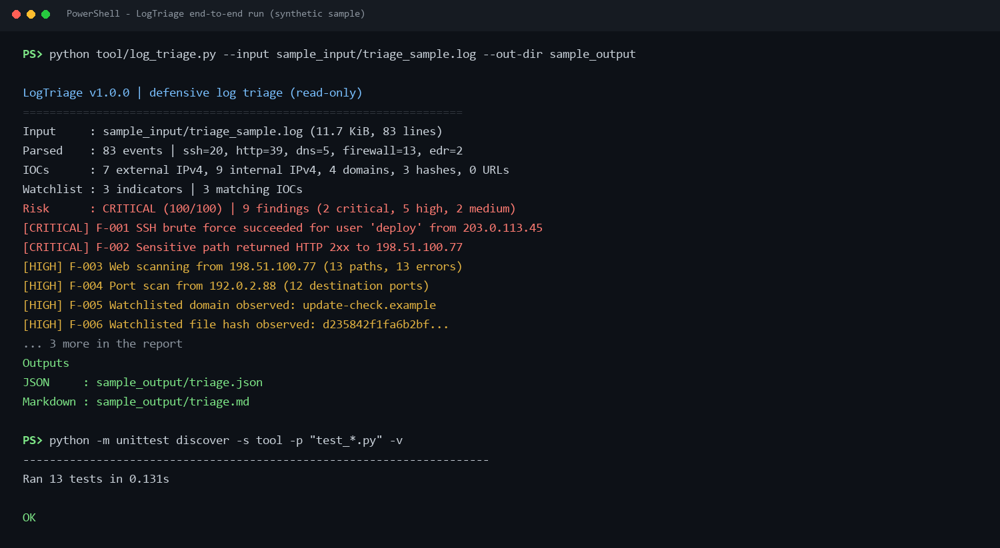
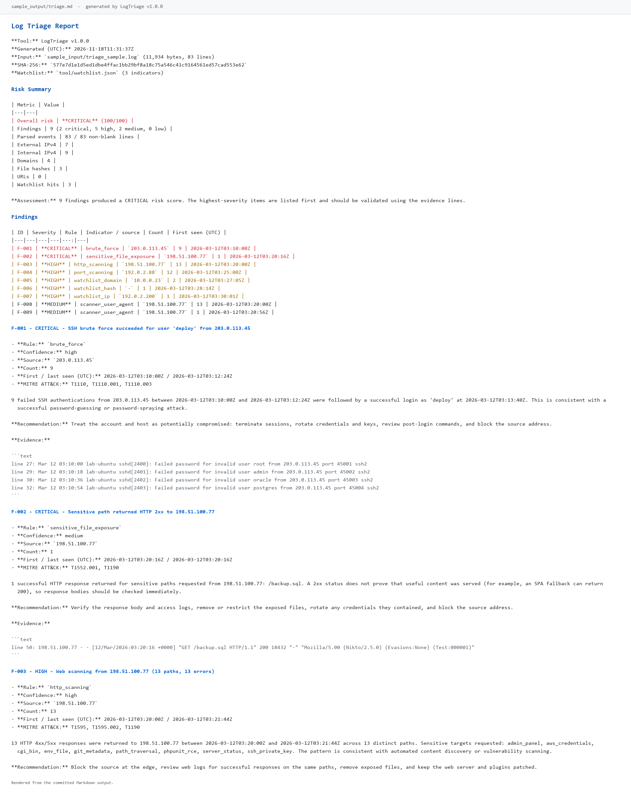
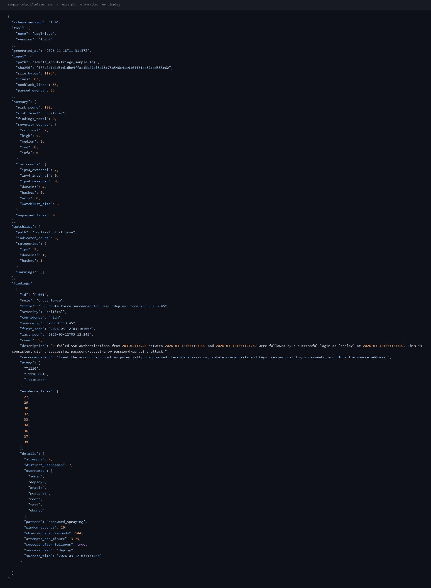

# Day 2 Mission Report - Manichand Gupta - Blue

## 1. Header

- **Candidate:** Manichand Gupta
- **Track:** Blue (Defensive Security)
- **Day:** Day 2
- **Date:** 18 November 2026
- **Time spent:** 3h 00m

## 2. Tool Objective

Build a working defensive log triage CLI that ingests a mixed text log,
extracts IPv4, domain, URL, and file-hash IOCs, correlates suspicious behaviour
such as brute force and scanning, and emits a structured Markdown + JSON
summary. The tool exists to shorten the first-pass triage loop while keeping the
analyst in control of validation.

## 3. Scope & Environment

- The work used a **self-owned isolated lab environment** and **synthetic data
  generated locally** from `sample_input/generate_sample.py`.
- The sample log is explicitly synthetic: RFC 5737 documentation addresses,
  RFC 1918 private addresses, reserved `.example` domains, invented users and
  hosts, and hashes of fixed demo strings.
- **Nothing was organizer-provided.** No real company data, PII, secrets, API
  keys, or live systems were used.
- The tool is defensive and read-only. It does not target, scan, or modify any
  remote system.

## 4. Tool Design

**Inputs**

- Text logs: OpenSSH auth logs, Apache/Nginx combined access logs, dnsmasq query
  logs, UFW/iptables block lines, and ISO-8601 endpoint/EDR lines.
- Optional local JSON watchlist (`tool/watchlist.json` by default).
- CLI thresholds with safe defaults (20-second correlation window, 5 failed SSH
  logins, 10 HTTP errors, 8 distinct blocked ports; a successful login within
  5 minutes of a burst is treated as critical).

**Outputs**

- `sample_output/triage.json` - structured summary with metadata, risk score,
  findings, grouped IOCs, evidence line numbers, timeline, stats, and
  limitations.
- `sample_output/triage.md` - human-readable report with risk summary, detailed
  findings, IOC tables, timeline, detection logic, and assumptions.

**Logic / flow**

```text
input log
   |
   v
ingest -> tolerant line parser (SSH / HTTP / DNS / firewall / EDR / generic)
   |
   v
IOC extraction and scope classification (IPv4, domains, URLs, hashes)
   |
   v
behavioural detectors
  - SSH failures clustered per source, success-after-burst check
  - HTTP 4xx/5xx clustered per source, distinct + sensitive paths
  - HTTP 2xx on sensitive paths
  - firewall blocks clustered by destination port
  - offensive scanner user-agents
  - local watchlist matches
   |
   v
severity weights -> 0-100 risk score -> sorted findings
   |
   v
JSON + Markdown reports and console summary
```

**Safety guards**

- Read-only: input is never modified; no shell execution; no network requests.
- No attacking capability and no target selection.
- 50 MiB input cap and 10,000-character line cap to bound memory/abuse.
- All log content is escaped or truncated before Markdown rendering.
- Watchlist and sample data are synthetic; no secrets or PII.

**Dependencies**

Python 3.10+ standard library only. `tool/requirements.txt` intentionally
contains no packages.

## 5. How to Run

From the repository root:

```bash
python -m pip install -r tool/requirements.txt
python tool/log_triage.py --input sample_input/triage_sample.log --out-dir sample_output
```

Expected console result: `CRITICAL (100/100)`, 9 findings, with JSON and
Markdown written to `sample_output/`.

Useful variants:

```bash
# JSON only, lower brute-force threshold, fail CI on high risk
python tool/log_triage.py -i sample_input/triage_sample.log --format json \
  --brute-threshold 4 --fail-on high

# Unit tests
python -m unittest discover -s tool -p "test_*.py" -v
```

**Sample input used:** `sample_input/triage_sample.log` (83 lines, synthetic
mixed log with five injected incidents).

## 6. Evidence Summary

- Command and console summary: 
- Rendered Markdown triage report: 
- JSON structure and first finding: 
- Repro steps and committed artifacts are in [README.md](README.md) and
  [sample_output/](sample_output/).
- Automated checks: 13 tests pass with `python -m unittest discover -s tool -p "test_*.py" -v`.

## 7. Results

The tool parsed all 83 non-blank lines and produced **9 findings** with a risk
score of **100/100 (CRITICAL)**:

1. **Critical - SSH brute force succeeded.** 9 failed logins from
   `203.0.113.45` across 7 usernames (`root`, `admin`, `oracle`, `postgres`,
   `test`, `ubuntu`, `deploy`) between 03:10:00 and 03:12:24, followed by a
   successful login as `deploy` at 03:13:40.
2. **Critical - sensitive file exposure lead.** `198.51.100.77` received
   `200 OK` for `/backup.sql` after a scanning burst. The report correctly
   labels this as requiring response-body validation.
3. **High - web scanning.** 13 HTTP errors across 13 distinct paths, including
   `/.env`, `/.git/config`, `/phpmyadmin/`, `/.aws/credentials`, and a path
   traversal attempt.
4. **High - port scanning.** 12 blocked connections from `192.0.2.88` across
   12 destination ports in 44 seconds.
5. **High - watchlist hits.** The synthetic watchlist matched a C2 IP
   (`192.0.2.200`), a malware-update domain (`update-check.example`), and a
   SHA-256 file hash on an EDR quarantine event.
6. **Medium - scanner user-agents.** Nikto and sqlmap signatures were extracted
   from the web requests.

IOC inventory: 7 external IPv4 addresses, 9 internal addresses (context only),
4 domains, 3 hashes (one watchlisted, two benign/clean), and 0 URLs.

## 8. Limitations / Next Step

**Known limits**

- Thresholds are static; production use needs per-host baselining and
  allowlists for known scanners and automation.
- Correlation is limited to one file and one process run; events are held in
  memory.
- Syslog timestamps lack a year; `--assume-year` is required for deterministic
  results across years.
- A 2xx response for a sensitive path can be a false positive (for example, an
  SPA catch-all); response-body validation is intentionally out of scope.
- IPv6 and non-text/compressed logs are not fully supported.
- The JSON report is a triage artifact, not a STIX/TAXII export.

**Day 3 improvement idea**

Add a small, offline enrichment layer: load a second "known-good" allowlist and
a threat-intel cache, support gzip/rotated logs, and emit a compact ATT&CK
coverage view. That would reduce false positives and make the tool practical
for a week of lab logs without changing its read-only safety model.

## 9. References / Sources

All references are public; no data was downloaded at runtime. Full list:
[sources/links.md](sources/links.md).

- MITRE ATT&CK T1110 Brute Force and T1110.003 Password Spraying
- MITRE ATT&CK T1595.002 Vulnerability Scanning and T1046 Network Service Discovery
- MITRE ATT&CK T1552.001 Credentials In Files
- RFC 5737 (IPv4 documentation ranges), RFC 1918 (private addressing), RFC 2606
  (reserved `.example` domains)
- Python 3 standard library documentation (`hashlib`, `ipaddress`, `json`,
  `argparse`)
- OWASP Logging Cheat Sheet and Nginx access-log documentation

The sample log was generated locally by
[`sample_input/generate_sample.py`](sample_input/generate_sample.py).

## 10. Self-Attestation

I self-sourced all materials, used only public/synthetic/self-owned resources,
built a working tool, and performed non-destructive work.
