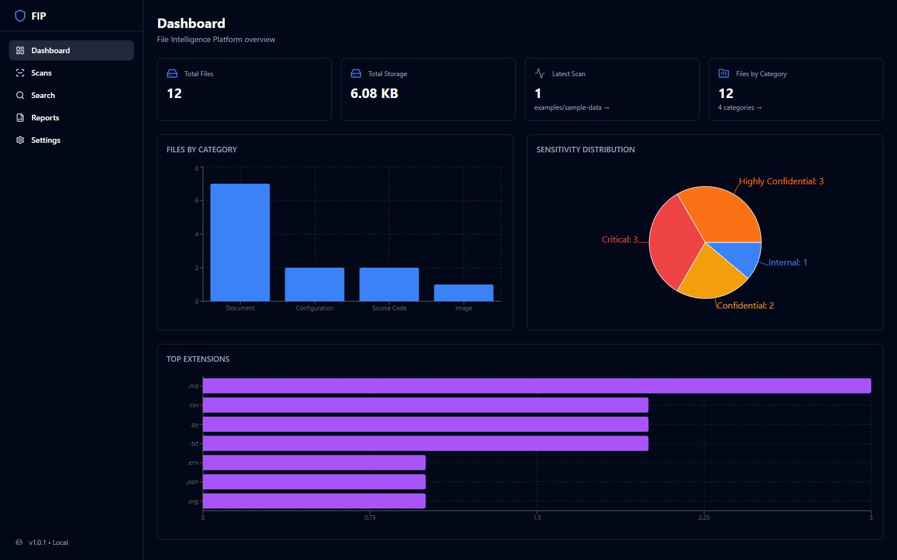
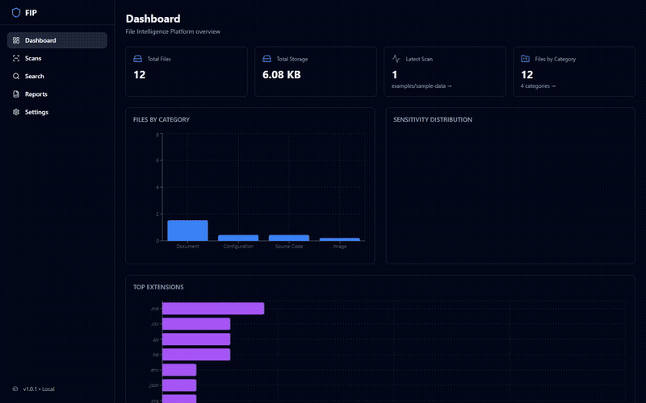

# File Intelligence Platform

**Local-first file inventory, content analysis, and sensitive-data discovery.**

[](LICENSE)

Point FIP at a directory and it builds a searchable catalog of what is actually
there: metadata, hashes, extracted text, file categories, duplicate groups, and
matches for credentials, personal data, cloud keys, private keys, and other
sensitive content. Everything runs on your machine against files you already
have access to.





## What you get

- **Recursive scans with control.** Start, pause, resume, and cancel a scan.
  Progress, file counts, and per-file errors are visible while it runs.
- **Metadata and integrity.** Size, timestamps, owner, permissions, MIME type
  and magic bytes, SHA-256, MD5, entropy, and duplicate grouping.
- **Content extraction.** PDF, Word, Excel, PowerPoint, Outlook `.msg`, plain
  text and source code, archives, executables, images, and media metadata.
- **Classification.** Files are bucketed into Documents, Source Code,
  Executables, Archives, Images, Media, and more, with an explanation.
- **Sensitive-data detection.** 40+ patterns across PII, financial data,
  credentials, cloud credentials, private keys, infrastructure, and network
  artifacts. Each file gets a 0–100 risk score and a level:
  Public, Internal, Confidential, Highly Confidential, or Critical.
- **Search and filter.** Full-text search over indexed content plus filters for
  extension, MIME type, category, sensitivity, size, date, owner, duplicates,
  and finding type.
- **Reports.** Executive summary (HTML/JSON), full inventory (CSV/JSON),
  sensitivity audit (CSV), duplicate groups (CSV), largest files (CSV), and
  category distribution (HTML/JSON).
- **Optional AI enrichment.** With a provider configured, a scan ends with one
  anonymized batch request that adds higher-level observations. Without a key,
  the platform is fully functional and fully offline.
- **One local process.** `run.py` builds the React app when needed and serves
  the API and GUI together on loopback. Docker Compose is available for an
  isolated deployment.

## Quick start

Requirements: **Python 3.12+**, **Node.js 20+** (only to build the browser app),
and a modern browser.

```powershell
git clone https://github.com/EclipseManic/file-intelligence-platform.git
cd file-intelligence-platform
python -m venv .venv
.venv\Scripts\Activate.ps1
pip install -r backend/requirements.txt
python run.py
```

On macOS or Linux, activate with `source .venv/bin/activate`.

`run.py` installs the frontend dependencies and builds the React app on the
first run, starts the API and GUI at <http://127.0.0.1:8000/>, and opens your
browser. Later runs skip work that is already up to date.

```bash
python run.py --port 8770       # different port
python run.py --no-browser      # do not open a browser
python run.py --build always    # force a frontend rebuild
python run.py --db ./my.db      # different SQLite database
python run.py --reset-db        # delete the default database first
python run.py --dev             # Vite dev server + API hot reload
python run.py --help
```

The server binds to `127.0.0.1` by default. Keep it there: the scanner can read
any file your user account can read.

### Docker

```bash
cp .env.example .env
docker compose up --build
```

- GUI: <http://127.0.0.1:3000/>
- API docs: <http://127.0.0.1:8000/api/docs>

Both published ports are bound to loopback. Host content is mounted
**read-only** at `/host-files`; set `HOST_SCAN_PATH` in `.env` to the directory
you want to inspect, and use `/host-files` as the scan path in the UI. The
default is the synthetic `examples/sample-data` folder.

## First scan

The repository ships a synthetic dataset with fake credentials and personal
data so you can see every feature immediately:

1. Open **Scans → New Scan**.
2. Enter the path to `examples/sample-data` (absolute path), for example
   `D:\code\file-intelligence-platform\examples\sample-data`.
3. Start the scan.
4. Follow the progress, then open the dashboard, **Search**, and **Reports**.

All sample values are fictional. They exist only to trigger detections.

## How it works

```
path ──▶ directory scanner ──▶ per-file analyzers ──▶ sensitive-data detector
                │                       │                       │
                ▼                       ▼                       ▼
          metadata, hashes        text, categories        findings, risk score
                └───────────────────────┴───────────────────────┘
                                        ▼
                             SQLite index ──▶ FastAPI ──▶ React GUI
```

- The **scanner** walks the path, skips configured system directories, and
  records metadata, hashes, entropy, and duplicate groups.
- The **analysis orchestrator** dispatches each file to the matching analyzer
  (PDF, Office, email, archive, executable, image, media, text/code).
- The **detector** runs compiled regular expressions over extracted text and
  produces findings plus an explainable risk score.
- The **API** serves scans, files, search, statistics, and report downloads.
- The **GUI** is a React single-page app served by the same process in local
  mode, or by nginx in Docker.

See [docs/ARCHITECTURE.md](docs/ARCHITECTURE.md) for the module map and data
model.

## Reports

| Report | Formats | Use |
|---|---|---|
| Executive summary | HTML, JSON | High-level totals and risk posture |
| Full file inventory | CSV, JSON | Every indexed file and its metadata |
| Sensitivity audit | CSV | Findings ordered by severity |
| Duplicate files | CSV | Duplicate groups and wasted storage |
| Largest files | CSV | The 100 largest indexed files |
| Category distribution | HTML, JSON | Counts by category |

Report downloads are generated on demand from the local database. Nothing is
uploaded.

## Optional AI enrichment

AI is **off by default**. Set one provider and its key in `backend/.env` (local
runs) or the root `.env` (Docker):

```ini
AI_PROVIDER=openrouter
OPENROUTER_API_KEY=sk-or-v1-...
OPENROUTER_MODEL=nvidia/nemotron-3-super-120b-a12b:free
```

Supported providers: `gemini`, `openrouter`, `openai`, `bazaarlink`, and
`none`. If a `GEMINI_API_KEY` is present and no provider is selected, Gemini is
enabled automatically.

When a provider is available, finishing a scan sends **one batch request** with
anonymized per-file summaries (type, size band, category, sensitivity, finding
counts) — not file contents or full paths. The results appear as scan insights.
If the request fails, the scan still completes and the error is logged.

## Project layout

```
file-intelligence-platform/
├── run.py                     # One-command launcher: build, serve, open
├── docker-compose.yml         # Loopback-only backend + nginx frontend
├── .env.example               # Compose settings
├── backend/
│   ├── app/
│   │   ├── main.py            # FastAPI app, security headers, SPA hosting
│   │   ├── core/              # Settings, async database, logging
│   │   ├── api/v1/            # Scans, files, search, stats, AI, reports
│   │   ├── models/            # SQLAlchemy models
│   │   ├── schemas/           # Pydantic request/response models
│   │   └── services/
│   │       ├── scanner/       # Directory walk, scan lifecycle
│   │       ├── analyzer/      # Per-format content extraction
│   │       ├── detector/      # Sensitive-data patterns and risk scoring
│   │       ├── ai/            # Optional providers and batch insights
│   │       └── report/        # CSV, HTML, and JSON reports
│   ├── tests/                 # 22 pytest tests (hermetic temp database)
│   └── requirements.txt
├── frontend/
│   └── src/                   # React + TypeScript + Tailwind GUI
├── examples/sample-data/      # Synthetic files for a first scan
└── docs/                      # Architecture notes and screenshots
```

## Configuration

Set these in `backend/.env` for local runs or the root `.env` for Compose.

| Variable | Default | Purpose |
|---|---|---|
| `DATABASE_URL` | `sqlite+aiosqlite:///./data/fip.db` | Database URL; relative SQLite paths resolve under `backend/` |
| `API_HOST` | `127.0.0.1` | Bind address; changing it exposes the scanner |
| `API_PORT` | `8000` | API port |
| `DEBUG` | `false` | Debug mode |
| `LOG_LEVEL` | `INFO` | Log level |
| `LOG_FORMAT` | `json` | `json` or text logs |
| `SCAN_DEFAULT_THREADS` | `4` | Directory scan concurrency |
| `SCAN_BATCH_SIZE` | `100` | Database batch size |
| `SCAN_MAX_DEPTH` | `100` | Maximum directory depth |
| `AI_PROVIDER` | `none` | `gemini`, `openrouter`, `openai`, `bazaarlink`, `none` |
| `GEMINI_API_KEY` / `OPENROUTER_API_KEY` / `OPENAI_API_KEY` / `BAZAARLINK_API_KEY` | unset | Provider credentials |
| `WATCH_ENABLED` | `false` | Enable watch-folder support when configured |

The database, logs, `.env` files, and build output are gitignored.

## Security and privacy

This is a **single-user local tool**, not a multi-tenant service. It has no
authentication because access is controlled by the loopback bind.

- The server refuses nothing by default beyond the loopback bind — do not run
  it on a shared or untrusted network.
- Scans read any path the process can read. Run it as your normal user, not as
  an administrator, and point it only at content you are authorised to inspect.
- Docker publishes ports on `127.0.0.1` only and mounts host content read-only.
- The API key stays in the environment and is never returned to the browser.
- No telemetry. The only outbound request is the optional AI batch call.
- `.env`, `data/`, and generated reports can contain sensitive information.
  They are gitignored; treat them accordingly.

See [SECURITY.md](SECURITY.md) for the threat model and reporting process.

## Testing

```bash
cd backend
python -m pytest -q
```

The suite has **22 tests** covering the detector, analyzers, scanner, scan API,
statistics, health endpoint, and AI fallback. It runs against a temporary database, so it
never touches your real data. Lint with `ruff check app tests`.

The frontend is type-checked and built with:

```bash
cd frontend
npm ci
npm run build
```

CI runs the backend tests on Ubuntu and Windows with Python 3.12 and 3.13, and
builds the frontend on Node 20.

## Limitations

- **Heuristics, not proof.** Sensitive-data matches are regular expressions.
  They produce false positives and will miss data that is encoded, encrypted,
  or stored in an unsupported format.
- **Text extraction is best-effort.** Scanned PDFs and images are not OCR'd.
  Password-protected documents and unsupported archives are skipped and logged.
- **Windows-oriented defaults.** The default exclusion list covers common
  Windows system directories. Adjust it for macOS or Linux.
- **Scale.** The SQLite index and single-process server are designed for a
  workstation-sized corpus, not a network share or millions of files.
- **AI output can be wrong.** It is an optional convenience, not a finding you
  should act on without verification.

## Ethical use

Use FIP only on systems and files you own or are explicitly authorised to
inspect. Finding a credential is not permission to use it. Report exposed
secrets through the appropriate channel and rotate them.

## License

MIT. Copyright (c) 2026 Eclipsemanic. See [LICENSE](LICENSE).
